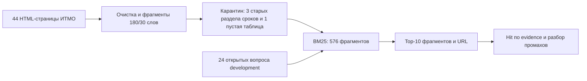
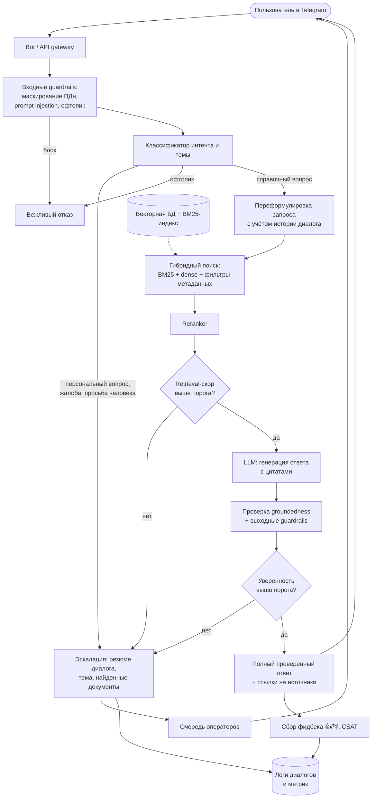
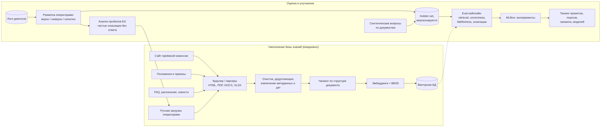

# ML System Design Doc — UniAssist: LLM-агент поддержки студентов и абитуриентов

> Документ составлен по [шаблону Reliable ML](https://github.com/IrinaGoloshchapova/ml_system_design_doc_ru/blob/main/ML_System_Design_Doc_Template.md).
> Статус: HW2, офлайн-исследование корпуса ИТМО; обновлено 11 ноября 2026 года. В §2.3 и отчёте EDA приведены измерения. Целевые бизнес/ML-значения остаются гипотезами; работающего сервиса и пилота нет.

## Глоссарий

| Термин | Значение |
|---|---|
| **Обращение** | Одна сессия диалога пользователя с ассистентом по одному вопросу |
| **Оператор** | Сотрудник приёмной комиссии, деканата или учебного офиса, который отвечает вручную |
| **Эскалация** | Передача обращения оператору вместе с историей диалога и найденными источниками |
| **Automation rate (AR)** | Доля обращений, закрытых ассистентом без оператора и без повторного обращения по той же теме в течение 24 ч |
| **CSAT** | Средняя оценка ответа пользователем (1–5) или доля 👍 среди оценённых ответов |
| **FRT** | First Response Time, время до первого содержательного ответа |
| **RAG** | Retrieval-Augmented Generation: LLM генерирует ответ на основе найденных фрагментов документов |
| **Groundedness** | Доля утверждений ответа, подтверждённых найденными источниками |
| **База знаний (БЗ)** | Корпус документов: положения, правила приёма, расписания, FAQ, новости |

---

## 1. Цели и предпосылки

### 1.1. Зачем идём в разработку продукта?

**Проблема.** Приёмная комиссия и учебные офисы вуза получают большой поток однотипных вопросов:
«какие проходные баллы», «когда последний день подачи документов», «как перевестись на бюджет», «где посмотреть расписание», «как оформить академический отпуск». Вопросы приходят через чаты, почту, телефон и соцсети. Пик нагрузки приходится на приёмную кампанию (июнь–август) и начало семестра.

Последствия:
- **Долгое ожидание ответа.** В пиковый сезон ответ приходит через часы или дни. Часть абитуриентов за это время уходит к конкурентам. Для вуза это прямая потеря сильных абитуриентов.
- **Перегрузка операторов.** По оценке (гипотеза, уточнить по логам), 60–80 % вопросов покрываются публичными документами и FAQ. Операторы тратят время на повторяющиеся ответы, а не на сложные случаи.
- **Ответы расходятся между собой.** Разные операторы отвечают по-разному, информация устаревает.
- **Информация распределена.** Она лежит на десятках страниц и в PDF-положениях. Пользователю трудно найти нужное самостоятельно.

**Бизнес-цель.** Снизить нагрузку на операторов и время ответа и при этом сохранить или повысить удовлетворённость пользователей. Для этого нужен круглосуточный ассистент, который отвечает на типовые вопросы по официальным документам со ссылками на источник и передаёт человеку то, в чём не уверен.

**Почему станет лучше от ML.**
- Классический FAQ-бот на правилах и кнопках не справляется с разнообразием формулировок и вопросами, ответ на которые нужно собрать из нескольких документов.
- Полнотекстовый поиск по сайту возвращает документ, а не ответ.
- LLM с RAG понимает свободные формулировки, синтезирует ответ из нескольких источников и цитирует их. Механизм уверенности позволяет не отвечать там, где модель может ошибиться.

**Что считаем успехом (целевые бизнес-метрики пилота, гипотезы):**

| Метрика | Текущее значение (оценка) | Цель пилота |
|---|---|---|
| Automation rate | 0 % | ≥ 50 % |
| Медианный FRT | часы (в пик — до суток) | ≤ 10 с |
| CSAT по ответам ассистента | — | ≥ 4.0 из 5 (или ≥ 75 % 👍) |
| CSAT по всем обращениям | baseline замерить до пилота | не ниже baseline |
| Доля фактически неверных ответов (аудит выборки) | — | ≤ 3 % |
| Нагрузка на операторов (обращений/день) | baseline замерить | −40 % |

### 1.2. Бизнес-требования и ограничения

**Предполагаемый заказчик:** приёмная комиссия и учебный офис ИТМО. Соглашения о пилоте и доступе к обращениям пока нет.
**Пользователи:** абитуриенты и их родители, студенты бакалавриата и магистратуры.
**Получатели эскалаций:** операторы приёмной комиссии и учебного офиса.

#### Функциональные требования

1. Ответы на вопросы на естественном языке (русский; английский — желательно для иностранных абитуриентов) по темам: правила приёма, сроки, документы, проходные баллы, стоимость обучения, общежития, расписание, учебные процедуры (перевод, отпуск, пересдачи), контакты.
2. Каждый содержательный ответ сопровождается **ссылкой на первоисточник** (документ или страницу и дату актуальности).
3. При низкой уверенности, отсутствии информации, чувствительной теме или явной просьбе пользователя ассистент **эскалирует обращение оператору**: передаёт историю диалога, классифицированную тему и найденные документы. Пользователь получает уведомление о передаче и ориентировочный срок ответа.
4. Многоходовый диалог: уточняющие вопросы («какой уровень образования?», «какая программа?»).
5. Сбор обратной связи: 👍/👎 по ответу и CSAT в конце диалога.
6. Каналы: Telegram-бот (MVP) и виджет на сайте (следующая итерация).
7. Обновление базы знаний без участия разработчиков: регулярная переиндексация публичных страниц и загрузка документов операторами.
8. Панель для операторов: очередь эскалаций, история диалогов, разметка «ответ верный/неверный».

#### Нефункциональные требования

| Требование | Значение |
|---|---|
| Латентность | p95 времени до полного проверенного ответа ≤ 10 с; ответ буферизуется до проверки groundedness и выходных guardrails. При превышении общего дедлайна 10 с — уведомление об эскалации |
| Пиковая нагрузка | до 50 входящих пользовательских сообщений/с кратковременно; 10 000+ диалогов/день — отдельная гипотеза суточного объёма, не постоянные 50 RPS |
| Доступность | 99.5 % в приёмную кампанию; при недоступности LLM сразу эскалировать оператору |
| Актуальность БЗ | изменения на сайте попадают в индекс ≤ 24 ч, критичные документы загружаются вручную ≤ 1 ч |
| Стоимость | ≤ 1–2 ₽ за обращение (LLM + инфраструктура), гипотеза, согласовать бюджет |

50 RPS относится к входу Bot/API, а не к LLM API. Одно сообщение может вызвать классификацию, переформулировку, генерацию и проверку. Нагрузка на LLM равна входному RPS × средней доле сообщений, дошедших до LLM, × среднему числу вызовов на такое сообщение. При доле 1 и четырёх вызовах это до 200 вызовов/с без повторов — сценарий для проверки квот, не подтверждённая мощность. Измеряем отдельно входной RPS, число LLM-вызовов, токены/с и число одновременных запросов; ограничиваем очередь и конкуренцию. При недоступности мощности эскалируем, соблюдая общий дедлайн. Длительность пика и число сообщений в диалоге уточняем по логам перед нагрузочным тестом.

#### Бизнес-ограничения

- **Юридическая ответственность за ответы.** Ассистент носит справочный характер. Официальные решения (зачисление, перевод, академические вопросы конкретного студента) он не принимает и не обещает. В интерфейсе есть дисклеймер.
- **Персональные данные (152-ФЗ).** В MVP ассистент не обращается к личным данным (оценки, статус заявления). Персональные данные, введённые пользователем, маскируются перед отправкой в LLM. Логи хранятся в контуре РФ. Если используется внешний LLM API, то это российский провайдер (YandexGPT, GigaChat) либо self-hosted open-source модель.
- **Недопустимые ошибки.** Неверные даты, сроки, суммы и проходные баллы критичнее, чем отказ отвечать. Precision ответов приоритетнее покрытия.
- **Только официальные источники.** Ответы строятся исключительно по базе знаний вуза. Общие знания LLM для фактов о вузе не используются.
- **Тон и этика.** Вежливый нейтральный стиль. Отказ на офтопик, провокации и prompt injection.
- **Ресурсы команды.** 1–2 разработчика, ~3 месяца до пилота, ограниченный бюджет на GPU.

#### Что ожидаем от итерации (MVP)

Рабочий прототип в Telegram на ограниченном домене (приёмная кампания магистратуры и бакалавриата + базовые учебные процедуры), офлайн-оценка на размеченном наборе вопросов и пилот на части трафика.

#### Бизнес-процесс пилота

1. Ассистент подключается в Telegram-канал приёмной комиссии. Операторы продолжают работать как обычно и получают эскалации в общую очередь.
2. **Фаза 1 (2 недели, shadow mode).** Ассистент генерирует ответы, но пользователю их не показывает. Операторы видят черновик и размечают его как верный, неверный или неполный. Так мы замеряем качество без риска для пользователей.
3. **Фаза 2 (4 недели, A/B).** Пользователи случайно распределяются 1:1 между ассистентом и текущим процессом при первом обращении. Назначение сохраняется по псевдонимизированному Telegram user ID на весь пилот; повторные обращения остаются в той же группе. Сравниваем FRT, CSAT, нагрузку на операторов и долю повторных обращений. Неопределённость оцениваем с учётом группировки обращений по пользователю. При смене аккаунта сквозная идентификация не гарантируется; это ограничение фиксируем в отчёте.
4. Еженедельно операторы аудируют случайную выборку из 100 фактически показанных ответов ассистента без повторного включения ответа. Если их меньше, проверяем все. Критическая ошибка — неверный срок, сумма, условие поступления или процедуры, способные изменить решение пользователя; неполноту и прочие фактические ошибки учитываем отдельно. Для воспроизводимости спорные случаи разбирают два оператора.

CSAT собираем одинаковым приглашением и шкалой в обеих группах. Вместе со средней оценкой показываем число приглашённых, число ответивших, долю ответивших (response rate), распределение оценок и доверительный интервал. При различающейся доле ответивших сравнение CSAT считаем описательным: оценка добровольной подвыборки не доказывает отсутствие ухудшения у всех пользователей. Если данных недостаточно, результат по CSAT признаём неопределённым.

**Успешный пилот:** в A/B AR ≥ 50 %, CSAT в тестовой группе не ниже контрольной, доля критических ошибок по аудиту ≤ 3 %, операторы готовы продолжать (опрос).

**Критерии остановки пилота:** серьёзный инцидент (например, неверный дедлайн привёл к пропуску подачи) или утечка ПДн — немедленная остановка автоматических ответов. Правило «больше 5 ошибок из 100 за неделю» не используем. Для статистической остановки на четырёх заранее назначенных недельных проверках объединяем накопленный аудит A/B-фазы. Останавливаем автоматические ответы, если односторонняя точная нижняя граница Клоппера—Пирсона уровня 98.75 % для доли критических ошибок превышает 3 %. Поправка Бонферрони 0.05 / 4 ограничивает суммарный риск ложной остановки четырёх проверок при независимых наблюдениях. Для этого контрольного расчёта включаем не более одного случайно выбранного ответа на пользователя за весь пилот; остальные проверенные ответы учитываем в описательной статистике и разборе инцидентов. Зависимость ошибок из-за общего дефекта базы знаний остаётся ограничением биномиальной модели; системный дефект разбираем отдельно. Любую обнаруженную ошибку исправляем сразу, не ожидая статистической остановки.

Итоговую долю критических ошибок публикуем с 95 % доверительным интервалом и объёмом аудита. Оценка ≤ 3 % остаётся целевым ориентиром; если интервал пересекает порог, выполнение порога статистически не подтверждено. Отсутствие остановки само по себе не означает успешный пилот.

#### Возможные пути развития

- Интеграция с личным кабинетом (статус заявления, персональное расписание) после авторизации.
- Виджет на сайте, VK, голосовой канал.
- Проактивные рассылки (напоминания о дедлайнах).
- Расширение на другие подразделения: общежития, военный учебный центр, международный отдел.
- Аналитика частых вопросов для улучшения сайта и документов.

### 1.3. Что входит в скоуп проекта/итерации, что не входит

#### Входит в скоуп итерации (MVP)

Для HW2 выбран поднабор: справочные вопросы абитуриентов бакалавриата ИТМО по снимку кампании 2026. Таблица ниже описывает целевой продукт; реализованный объём и ограничения перечислены в §2.3.

| Бизнес-требование | Как закрываем |
|---|---|
| Ответы на типовые вопросы абитуриентов и студентов | RAG по базе знаний из публичных источников вуза |
| Ссылки на источники | Цитирование чанков с URL и датой документа |
| Эскалация при неуверенности | Модуль оценки уверенности + классификатор тем, требующих человека |
| Многоходовый диалог | Хранение контекста сессии, переформулировка запроса с учётом истории |
| Обратная связь | 👍/👎 и CSAT в Telegram |
| Обновление БЗ | Ежедневный краулер + ручная загрузка документов |
| Офлайн-оценка качества | Golden set (300–500 вопросов) и автоматический eval-пайплайн |
| Мониторинг | Логи, метрики латентности, стоимости, AR и эскалаций |

#### Не входит в скоуп итерации

- Доступ к персональным данным и личному кабинету, авторизация.
- Действия от имени пользователя (подача заявлений, запись на пересдачу).
- Сайт-виджет, голосовой канал, другие мессенджеры.
- Полноценная панель операторов. В MVP эскалации уходят в рабочий Telegram-чат операторов, разметка ведётся через простую веб-форму или таблицу.
- Дообучение (fine-tuning) LLM. Используем готовые модели и prompt engineering.
- Английский язык (поддерживается «как получится», без отдельной оценки качества).

#### Результат с точки зрения качества кода и воспроизводимости

- Репозиторий с настроенными линтерами (ruff), mypy, pre-commit и CI.
- Код разбит на модули: ingestion, retrieval, agent, bot, eval. Конфигурация через `.env`/YAML.
- Воспроизводимый запуск через Docker Compose (бот, API, векторная БД, мониторинг).
- Eval-пайплайн запускается одной командой и логирует результаты (MLflow).
- Версионирование golden set и снапшотов БЗ.
- Unit-тесты на парсинг, чанкинг и логику эскалации.

#### Планируемый технический долг

- Простая эвристика оценки уверенности вместо откалиброванной модели. Калибровку делаем после сбора данных пилота.
- Парсинг сложных PDF (таблицы проходных баллов) частично ручной.
- Без продвинутого кэширования ответов и семантического кэша.
- Панель операторов на минимальном уровне.

### 1.4. Предпосылки решения

**Данные:**

| Источник | Пример содержимого | Формат | Частота обновления |
|---|---|---|---|
| Сайт приёмной комиссии | правила приёма, сроки, перечень документов, стоимость | HTML | раз в сезон, изменения в кампанию — еженедельно |
| Положения и приказы | положение о переводе, об академическом отпуске, правила пересдач | PDF/DOCX | редко |
| Официальный FAQ | готовые пары «вопрос — ответ» | HTML | редко |
| Проходные баллы и конкурсные списки | таблицы по программам | HTML/PDF/XLSX | ежегодно, в кампанию — ежедневно |
| Расписание | расписание занятий и сессии | HTML/API | каждый семестр |
| Новости и объявления | изменения сроков, дни открытых дверей | HTML | ежедневно |
| Исторические обращения (если заказчик предоставит) | вопросы пользователей и ответы операторов | выгрузка чатов/почты | разово + поток из пилота |

- Публичные данные доступны для сбора. Нужно соблюдать robots.txt и лицензионные ограничения.
- Исторические обращения нужны для построения golden set и распределения тем. Их обезличиваем до использования. Если их нет, генерируем вопросы синтетически (LLM по документам) и собираем у студентов-волонтёров. Происхождение каждого вопроса сохраняем: реальное обращение, независимый вопрос волонтёра или синтетика. Recall@5, MRR@10 и качество ответов публикуем отдельно для этих источников с размером подвыборки; синтетика не заменяет проверку на живых формулировках. Если реальных обращений нет, качество на них считаем неизмеренным.
- Прежняя оценка расширенной БЗ: 500–2 000 документов, 20–50 тыс. чанков (гипотеза для более широкого продукта). Фактический HW2-снимок: 44 HTML, 631 фрагмент, из них 576 допущены к поисковому эксперименту; детали и ограничения в §2.3.

**Ключевые предпосылки и допущения:**
- Большинство вопросов имеют ответ в публичных документах (гипотеза: ≥ 60 %). Проверяем на выборке исторических обращений до разработки.
- Ответ всегда даётся на один вопрос в контексте одной сессии. Долгосрочная память о пользователе не нужна.
- Документы на сайте считаются истиной. Если они противоречат друг другу, приоритет у более свежего документа, а сам конфликт эскалируется.
- Актуальность важнее полноты: у каждого чанка есть дата. Устаревшие документы (например, правила прошлого года) помечаются и понижаются в выдаче.
- Пользователи готовы общаться в Telegram (основной канал коммуникации абитуриентов).
- Операторы готовы разбирать эскалации и размечать ответы в пилоте (нужно согласовать с руководителем приёмной комиссии).

---

## 2. Методология

### 2.1. Постановка задачи

С технической точки зрения задача раскладывается на несколько подзадач:

1. **Retrieval (информационный поиск).** По запросу пользователя с учётом истории диалога найти top-k релевантных фрагментов базы знаний.
   - Гибридный поиск: dense (эмбеддинги, например `bge-m3` / `multilingual-e5-large`) + sparse (BM25), слияние через Reciprocal Rank Fusion, затем cross-encoder reranker (`bge-reranker-v2-m3`).
   - Фильтрация по метаданным: уровень образования, год, тип документа.
2. **Генерация ответа (grounded QA).** LLM формирует ответ только на основе найденных фрагментов, с цитированием источников. Если информации нет, модель должна это явно сказать.
3. **Маршрутизация и решение об эскалации (selective prediction).** Бинарная классификация «отвечать или эскалировать» на основе признаков:
   - классификатор интента и темы (FAQ / процедурный вопрос / персональный вопрос / жалоба / офтопик);
   - скоры retrieval и reranker (максимальный скор, разрыв между top-1 и top-2);
   - groundedness-проверка ответа (LLM-as-judge или NLI-модель): подтверждены ли утверждения источниками;
   - явная просьба позвать человека, негативная тональность, чувствительные темы.
   В MVP это пороговые правила, в следующей итерации — откалиброванная модель (логрег/бустинг) на размеченных данных пилота.
4. **Guardrails.** Детекция prompt injection и офтопика, маскирование ПДн на входе, проверка выхода на запрещённый контент.

Такой многошаговый процесс оформляем как **агент** (граф состояний, например на LangGraph): узлы классификации, переформулировки запроса, поиска, генерации, проверки и эскалации. Инструменты агента: `search_kb`, `get_schedule`, `escalate_to_operator`.

**Вход:** текст сообщения пользователя, история сессии (последние N реплик), метаданные канала.
**Выход:** ответ с цитатами **или** эскалация (тема + краткое резюме диалога + найденные источники для оператора).

**Бейзлайн.** В HW2 реализован BM25-поиск по фрагментам выбранного корпуса со ссылками на страницы. FAQ-only поиск и пороговая эскалация — следующий простой компаратор. Пока порог не откалиброван, score не трактуем как уверенность; качество сгенерированных ответов не измерялось.

**Разделение данных.** Golden set из 300–500 вопросов — стартовый набор для разработки, а не достаточное доказательство precision ≥ 0.97. До настройки фиксируем разделение 40/20/40 на development, calibration и закрытый test (суммарно 60/40, как в первой итерации). Переформулировки, вопросы из одной сессии и близкие дубликаты исходного вопроса держим в одной части; доли источников и тем по возможности сохраняем. На development выбираем промпты и retrieval, на отдельной calibration — порог эскалации. Test используем только для итоговой проверки зафиксированной конфигурации; после просмотра и последующих изменений нужен новый независимый test.

Precision считаем среди неэскалированных ответов закрытого test и приводим 95 % интервал Уилсона, coverage и число ответов. При 400 вопросах и coverage 0.6 даже без разделения было бы лишь около 240 ответов; test после разделения ещё меньше. Если нижняя граница интервала ниже 0.97, целевой уровень не считаем доказанным, даже при точечной оценке ≥ 0.97. Нужный объём дополнительной ручной разметки планируем отдельно по допустимой ширине интервала и ожидаемой частоте ошибок.

**ML-метрики (офлайн, на закрытом test):**

| Компонент | Метрика | Целевое значение (гипотеза) |
|---|---|---|
| Retrieval | Recall@5, MRR@10 | Recall@5 ≥ 0.85 |
| Генерация | Answer correctness (LLM-judge + ручная проверка выборки) | ≥ 0.85 |
| Генерация | Faithfulness / groundedness | ≥ 0.95 |
| Генерация | Citation accuracy (цитата подтверждает утверждение) | ≥ 0.9 |
| Эскалация | Precision ответов среди неэскалированных (= 1 − доля ошибок) | ≥ 0.97 |
| Эскалация | Coverage (доля вопросов без эскалации) при заданной precision | ≥ 0.6 |
| Классификатор тем | macro-F1 | ≥ 0.8 |
| Guardrails | Доля пропущенных prompt injection на тестовом наборе | ≤ 2 % |
| Система | p95 латентность, стоимость за обращение | ≤ 10 с, ≤ 2 ₽ |

Главный компромисс — **coverage против precision**. Порог эскалации подбираем только на отдельной calibration по кривой risk–coverage, максимизируя coverage при целевой precision ≥ 0.97; результат независимо проверяем на закрытом test. Именно он напрямую определяет бизнес-метрику AR.

**Связь ML-метрик с бизнес-метриками:**
- Coverage × (1 − доля повторных обращений) ≈ Automation rate.
- Precision / answer correctness → CSAT и доля критических ошибок.
- Латентность → FRT.

### 2.2. Блок-схема решения

#### Реализованный офлайн-бейзлайн HW2

#### Онлайн-контур: обработка обращения

#### Офлайн-контур: база знаний, оценка, улучшение

### 2.3. Этапы решения задачи

Состояние на 11 ноября 2026 года. **Выполнено:** сбор разрешённых HTML-страниц, EDA, открытый набор разработки и поисковый BM25-бейзлайн. **Запланировано:** независимая разметка, закрытый test, dense/hybrid retrieval, генерация, маршрутизация и сервис. Ниже результаты измерений отделены от критериев будущих этапов.

#### Этап 1. Подготовка данных

**Границы итерации.** Русскоязычные справочные вопросы о поступлении на бакалавриат ИТМО: документы, сроки кампании 2026, минимальные баллы, индивидуальные достижения, олимпиады, программы, общежития и публичные контакты. Снимок загружен в ноябре 2026 года. Он подходит для офлайн-исследования кампании 2026, но не подтверждает правила 2027 года. Учебные процедуры студентов, магистратура, визовые вопросы, персональные статусы и действия в личном кабинете вне текущего корпуса.

**Данные и сущности.**

| Сущность / признаки | Доступность и источник | Получение и ответственный | Проверка качества |
|---|---|---|---|
| Исходная страница: URL, HTML, SHA-256, время загрузки | Официальный портал `abit.itmo.ru`; 44 HTML в выбранном снимке | DS/DE: последовательный HTTP GET, не чаще 1 запроса/с | Статусы, лимит размера, allowlist, robots.txt, сохранение оригинала |
| Документ: текст, тема, уровень образования, область действия | Очищенный текст HTML, реестр источников и журнал проверки | DS: извлечение `main`/`article`, при отсутствии — `body`; разметка метаданных | EDA длины, повторов, годов, таблиц; детальная проверка контрольных страниц |
| Фрагмент: текст, source ID, URL, char offsets, размер | 631 окно по 180 слов с перекрытием 30 | DS: детерминированное разбиение; 576 фрагментов допущены к поисковому эксперименту | Смещения восстанавливают исходный текст; числовые значения не удаляются как повторы |
| PDF нормативных документов | 15 ссылок найдены, автоматическая загрузка закрыта `/file_storage/` | Владелец контента: разрешённый экспорт / предоставленные файлы; в этой работе не получены | Содержимое и качество PDF **не исследованы**; есть реестр пропусков |
| Вопрос пользователя и контекст сессии | Реальных обращений нет | В будущем заказчик/волонтёры, после обезличивания | Распределение тем и реальное покрытие сейчас неизвестны |

| Целевая переменная / разметка | Что есть сейчас | Для чего нужна и что ещё требуется |
|---|---|---|
| Релевантный фрагмент: `question_id → URL + evidence offsets` | 24 вопроса, составленных моделью по прочитанным источникам; по одному известному подтверждению | Проверка поискового контура. Нужны альтернативные релевантные фрагменты и независимая проверка |
| Действие: ответ / уточнение / оператор / отказ | 12 модельных сценариев: персональные данные, неясный запрос, будущие сроки, injection, неполная таблица | Спецификация маршрутизации; её качество пока не измерено |
| Правильность, подтверждённость и цитаты ответа | Размеченных ответов работающей LLM нет | Инструкция разметки, независимые оценки, разбор расхождений |
| Темы, происхождение вопроса, группа переформулировок, split | Все 36 случаев — открытый `development`, происхождение явно указано | Закрытые calibration/test пока не созданы; текущие случаи туда переносить нельзя |

**Наблюдения EDA и решения.** Полный разбор, графики и таблицы: [отчёт EDA](../reports/eda.md), [ноутбук](../notebooks/01_itmo_corpus_eda.ipynb), [диагностика снимка](../reports/data/20261111_itmo_bachelor_reviewed_v2/).

- 44 HTML занимают 16 981 098 байт; после извлечения — 719 463 символа, 92 892 слова. Медиана длины — 2 414,5 слова, максимум — 13 302. Это фактический стартовый корпус, прежняя оценка 500–2 000 документов не является результатом сбора.
- 27 из 44 документов — паспорта программ. Частота документов по темам не равна частоте вопросов пользователей; при разметке нужна отдельная тематическая квота.
- У 29 документов повторные строки длиной от 30 символов составляют не менее 10% текста. Между документами найдено 296 пар с Jaccard по множествам 5-грамм ≥ 0,35. Это кандидаты на общий шаблон, а не 296 доказанных дубликатов. Целые документы с разными программами автоматически не удаляем.
- В трёх паспортах программ раздел сроков содержит начало приёма 2025 года. Эти документы целиком помещены в карантин до разметки секций. Год диплома олимпиады или постановления сам по себе не доказывает устаревание документа.
- Страница `/page/71` содержит 49 слов и заголовки таблицы мест без значений. Она исключена из индекса. Недостающие значения не восстанавливаем догадками; нужен разрешённый экспорт или проверенный источник строк таблицы.
- В шести источниках отмечены смешанные уровни образования, включая `/page/86`, где разметка исправлена после детальной проверки. Метаданные ещё не проверены на уровне каждой секции. Следующий шаг — метаданные на уровне секции, а не только URL. В поисковом эксперименте фильтрация уровня по секциям ещё не реализована.
- У 35 документов в исходном реестре не подтверждён единый год кампании; это не 35 доказанных устаревших документов. `fetched_at`, год в тексте, год в имени файла и `valid_for_campaign` — разные поля.
- PDF не скачаны из-за политики обхода, поэтому разнообразие форматов и риск OCR не оценены. Наличие HTML-версии правил не доказывает её полную эквивалентность PDF с приложениями.

**Генерация и поступление данных.** Источник создаётся редакторами официального сайта: информационные страницы, паспорта программ, нормативные файлы и FAQ. Для HW2 выполнен разовый снимок; регулярный сбор пока не развёрнут. Планируемый процесс: ежедневная проверка разрешённых URL, новые версии по изменению хеша, очистка, контроль схемы и качества, карантин, формирование нового индекса, проверка контрольных вопросов, атомарная смена версии. В приёмную кампанию изменения критических сроков и сумм должны подтверждаться владельцем контента; SLA 24 часа остаётся требованием, не измерением.

Сохраняем исходный файл, очищенный текст, URL/parent URL, SHA-256, дату загрузки, версию кода и зависимостей. Старый индекс и источники остаются для воспроизведения и отката. При недоступном источнике не подменяем его пустым текстом и не удаляем последний рабочий индекс. Истечение срока проверки критического документа запрещает автоматические ответы по нему.

Сейчас чанкинг — контрольный вариант по словам, без токенизатора LLM и без гарантии сохранения строки таблицы или пары FAQ. Его нельзя считать финальной предобработкой. Для MVP: выделение разделов и пар FAQ, сохранение заголовка, сериализация таблиц в записи «объект → поле → значение», отдельные метаданные уровня/года. Для PDF после получения: постраничное извлечение, визуальная сверка таблиц, OCR только при недостатке текстового слоя. В этой итерации PDF-проверка и OCR не выполнены.

**Достаточность данных.** Для проверки ingestion и слабого поискового бейзлайна корпус достаточен. Для оценки спроса, automation rate и precision ответов — недостаточен: нет реальных обращений, независимого test и ответов работающей системы. Расширяем корпус по пробелам контрольных вопросов, а не до произвольного числа страниц.

Стартовый план разметки — 300–500 вопросов: реальные обезличенные обращения при доступности, независимые вопросы волонтёров и отдельно синтетические случаи. Внутри каждого источника обеспечиваем темы, неоднозначные запросы и отсутствие ответа. Сначала 50–100 независимых вопросов помогут уточнить квоты; их используем для разработки, не как финальный test. Не менее 20% будущей разметки проверяют два человека; спорные случаи проходят согласование. Нет доступа к обращениям — прямо указываем, что качество на них не измерено.

Для целевой precision ≥ 0,97 нужен отдельный расчёт объёма: даже при нуле ошибок двусторонняя 95% нижняя граница Уилсона достигает 0,97 лишь начиная со 125 принятых ответов. При coverage 0,6 это не менее 209 тестовых вопросов в идеальном случае без ошибок. Любая ошибка увеличивает требуемый объём; эти числа не являются гарантией достаточности и не заменяют репрезентативность. Планируем сбор после предварительной оценки частоты ошибок на development; тест фиксируем заранее, не добавляем наблюдения до удобного результата.

**Конфиденциальность и распространение.** В корпусе есть публичные имена и контакты сотрудников; email найдены в 30 документах. Публичность контакта не означает отсутствие персональных данных. Автоматические regex-флаги не являются полной проверкой ПДн. Результаты экзаменов с идентификаторами не включены в рабочий корпус. Нет доступа к личным кабинетам, паспортным данным или обращениям. Не публикуем полные исходные тексты и значения контактов в диагностических CSV: они остаются локально в игнорируемых `data/raw/` и `data/processed/`. В репозитории — ссылки, хеши, агрегаты, код и короткие собственные формулировки вопросов. Условия повторного распространения корпуса отдельно не подтверждены.

Для будущих диалогов: минимизация полей, маскирование перед внешним LLM, разграничение доступа, согласованный срок хранения, удаление по регламенту. Конкретные правовые основания и допустимый провайдер требуют согласования с владельцем данных до пилота; учебный сбор не выдаём за согласованный процесс университета.

**Риски и снижение.** Неполные таблицы → карантин и проверенный экспорт; устаревшие сроки → область действия и владелец контента; смешение уровней → секционная разметка; шаблонные повторы → точные и близкие дубликаты на уровне блоков с сохранением числовых записей; недоступный PDF → отчёт о пробеле; синтетические вопросы → отдельные метрики и независимая выборка; дрейф сайта → контрольные тесты и новая версия парсера.

**Необходимый результат этапа:** версионированный корпус с реестром и ошибками, EDA с решениями для системы, явные ограничения покрытия, набор вопросов с происхождением и подтверждениями, воспроизводимые команды. Для перехода к продуктивному MVP дополнительно требуются секционная разметка критических полей и проверка независимым человеком.

#### Этап 2. Подготовка прогнозных моделей

**Постановка и гранулярность.** Для одного запроса и контекста диалога ищем фрагменты, формируем подтверждённый ответ и выбираем действие. Горизонта временного прогноза нет: ответ должен быть верен для запрошенной кампании и версии БЗ. Запрос без года или категории сначала уточняем, если они меняют ответ. Переиндексация — при изменении корпуса, пересмотр моделей — по результатам анализа ошибок; обучение по каждому новому документу не требуется.

**Что реализовано.** Поиск BM25 по 576 допущенным фрагментам, `k1=1.5`, `b=0.75`; Unicode-регулярное выражение для букв/цифр, lowercase, `ё→е`, без стемминга, стоп-слов и подбора параметров. Сортировка при равных scores детерминирована. Запуск: `make baseline` на новом output ID при повторе. Бейзлайн возвращает ранжированные фрагменты и ссылки; автоматический ответ или эскалация ещё не реализованы. FAQ-only поиск остаётся запланированным простым компаратором, но его результаты не измерены.

На 24 модельных вопросах `development`: известная страница среди первых пяти фрагментов найдена в 16 случаях; полный размеченный подтверждающий span — в 12; evidence MRR@10 = 0,381. Это диагностические Hit@5 и MRR относительно одного известного подтверждения, **не Recall@5 по исчерпывающей разметке**, не закрытая оценка и не качество ответов. 12 сценариев маршрутизации не включались в эту метрику. Подробности: [отчёт бейзлайна](../reports/baseline.md), [результаты по вопросам](../reports/baseline/bm25_dev_v1/per_question.csv).

**Метрики и функции потерь.**

| Компонент | Метрика и причина выбора | Loss / оптимизация |
|---|---|---|
| Поиск | Hit@k для известного evidence; после расширения qrels — Recall@5, MRR@10, nDCG@10. Проверяем нахождение подтверждения, а не просто нужного URL | У BM25 нет обучения и loss. Если понадобится fine-tuning энкодера: contrastive / multiple-negatives loss на `(query, positive, hard negatives)` только из train |
| Reranker | nDCG@10, Recall после reranking; парное сравнение с тем же retrieval | Для готовой модели обучения нет; возможное развитие — pairwise ranking loss на проверенных парах |
| Ответ | Answer correctness: доля полностью правильных ответов по рубрике; отдельно критические ошибки, полнота и даты | LLM не дообучаем, loss не оптимизируем. Выбираем prompt/контекст по development; judge не единственный арбитр |
| Подтверждённость | Доля проверяемых утверждений, подтверждённых источниками; citation accuracy — доля корректно привязанных утверждений среди процитированных | Пропущенные цитаты считаем отдельно; ответ без проверяемых утверждений имеет N/A, а не автоматическую единицу |
| Ответить / эскалировать | Precision = правильные принятые ответы / все принятые; coverage = принятые / все запросы; risk–coverage и доля пропущенных критических ошибок | Сначала правила и порог. При обучении: binary log-loss, стоимость опасного принятия выше лишней эскалации; затем отдельная калибровка вероятности |
| Интент / тема | macro-F1 и confusion matrix, чтобы частая тема не скрыла редкие опасные классы | Cross-entropy / multinomial log-loss, при дисбалансе веса классов на train |
| Сервис | p50/p95 полного цикла, TTFT, память, стоимость запроса, ошибки API | Ограничения при выборе конфигурации, а не качество только по скорости |

Целевые значения из §2.1 остаются гипотезами. Снижение ошибок должно повышать корректность и CSAT, а coverage при фиксированной корректности — потенциальную автоматизацию. Офлайн coverage не равна бизнес-AR: нужны завершение вопроса и отсутствие повторного обращения. На текущих данных AR и CSAT не оцениваем.

**Схема валидации.** Текущие 36 случаев полностью открыты и относятся к development. Следующий набор перед экспериментами делим группами примерно 40% development, 20% calibration, 40% закрытый test: прежние 60/40 сохраняются как сумма development+calibration против test. При будущем дообучении train собирается отдельно от calibration/test. Сессии, переформулировки, близкие дубликаты и один шаблон синтетической генерации держим в одной части. Для запросов по одному и тому же документу избегаем искусственных перефразов одних ответов в разных частях; учитываем связанные группы при неопределённости.

Корпус БЗ целиком доступен поиску — это нормальное условие RAG. Запрещена передача эталонных ответов, evidence-разметки и test-вопросов в настройку retrieval, prompt, порогов или обучение. Дополнительно нужен временной срез: новая кампания и изменённые документы, чтобы проверить конфликт годов и устаревание.

На development выбираем предобработку, модели, размер контекста и prompt. На calibration фиксируем порог принятия и, при необходимости, калибратор. Оптимизируем coverage при требуемой точности с учётом её неопределённости; score BM25 не является вероятностью правильности. После фиксации конфигурации test запускаем один раз. При изменениях после просмотра test следующая итоговая оценка требует нового независимого набора. Метрики публикуем отдельно по происхождению, теме, году и answerability, с числом наблюдений. Для precision — интервал Уилсона; для сравнений retrieval — парный bootstrap по группам запросов, а при общей генерации по документам — с сохранением связанных вопросов. Зависимость и малый объём не скрываем узким интервалом по фрагментам.

**Развитие от бейзлайна к MVP.**

1. До тяжёлых моделей: исправить структуру FAQ и таблиц, выделить повторяющиеся общие блоки, добавить `education_level`, `valid_from/to`, `campaign_year`, section ID. Сравнить BM25 с русским стеммингом и без него; FAQ-only оставить отдельным компаратором.
2. Сравнить готовые multilingual dense-энкодеры из стека с BM25 на одних development-вопросах и одном снимке. Выбор модели пока не сделан, веса не скачивались.
3. Добавить hybrid BM25+dense через RRF, затем reranker. Проверять ablation: вклад каждого шага, прирост качества и задержка. Настраивать top-k, размер/overlap фрагментов и число кандидатов только на development; хранить все конфигурации и результаты, а не только лучшую.
4. Для генерации сравнить 2–3 доступные модели по correctness, groundedness, цитатам, цене и полному времени. Начать с короткого ответа по источникам, запретить выполнение инструкций из документов; при конфликте — уточнение или оператор. Использование платного API и передача реальных диалогов не требуются для HW2.
5. Дообучение имеет смысл только после анализа устойчивых ошибок и появления достаточного train; оно не является обязательным следующим шагом.

**Анализ и интерпретация.** Для каждого промаха сохраняем query ID, top-k source/chunk ID, scores, версию индекса и истинный evidence. Причины: морфология/синонимы, общий шаблон вместо целевого блока, разрыв вопроса и ответа, табличная связь, неверный год/уровень, отсутствие ответа, неоднозначность. Полезный URL без доказательства не засчитывается как правильный ответ. По текущему прогону часть evidence-промахов попадает в правильную страницу, часть — в общие блоки программ; некоторые альтернативные документы могут содержать верное подтверждение, но текущие qrels не исчерпывающие. Поэтому нельзя все 12 промахов назвать фактическими ошибками ответа.

Для принятого ответа журнал должен показывать подтверждение каждого существенного утверждения, год источника, score поиска и причину принятия. Для эскалации — причину отказа и найденные материалы. Не трактуем внимание LLM или её самооценку уверенности как доказательство корректности.

**Риски:** лексический bias синтетики → независимые вопросы; утечка test → заморозка и хеши; неверный judge → ручной аудит и рубрика; переобучение порога → отдельная calibration; дорогая модель без полезного прироста → парные ablation и бюджет; ошибки таблиц → проверка структуры до замены модели; изменение API/модели → версии и повторная оценка.

**Необходимый результат этапа:** воспроизводимый измеренный бейзлайн, инструкция разметки, закрытая схема оценки и сравнение кандидатов с учётом стоимости. В HW2 реализован только поисковый старт; достижение целевых precision/coverage и работающий RAG не заявляются.

#### Этап 3. Актуальность, конфликты и выпуск базы знаний

**Бейзлайн:** ручной утверждённый список URL, фиксированный снимок и карантин. **MVP:** ежедневный процесс изменений, секционные даты, хеши и атомарная версия индекса. Изменение даты/суммы/условия поступления ставит документ на проверку владельцу контента. PDF или HTML не получают приоритет только из-за более позднего времени скачивания: важны область действия и утверждённая редакция.

Контрольные случаи: срок 2025 на паспорте против правил 2026, вопрос о 2027, минимальный против проходного балла, бакалавриат против магистратуры, недоступная таблица. При конфликте источник не выбирается молча по максимальному retrieval-score: нужен подтверждённый приоритет нормативного документа либо оператор. Метрики: доля критических полей с подтверждённой областью действия, время от изменения до обновления, число конфликтов и пропусков парсинга. Текущие 35 неполностью датированных документов показывают, что ворота выпуска ещё не пройдены.

Результат: release manifest корпуса/индекса, протокол проверки критических фактов и возможность отката. Риск незаметной смены HTML → автоматические проверки известных разделов, счётчиков таблиц и резких изменений длины.

#### Этап 4. Подтверждённые ответы и маршрутизация

**Бейзлайн:** выдача фрагментов с URL для разработчика; работающего пользовательского канала нет. **MVP:** сначала запрос на уточнение при недостающем годе/категории, затем поиск, генерация, проверка утверждений и решение о показе. Никаких запросов к личному кабинету и действий от имени пользователя.

Схема действий: персональный статус / индивидуальное решение / нет подтверждения / конфликт → оператор; неоднозначный запрос → уточнение; off-topic и запрос секретов → отказ; обычный вопрос с достаточным актуальным подтверждением → ответ со ссылками. Документы считаются данными, а не инструкциями агенту. Кнопка вызова человека доступна всегда. Для будущего многоходового контекста проверяем смену года, программы и отрицания, а не только одиночные запросы.

Тестируем готовые 12 сценариев и расширяем их независимо от положительных вопросов. Измеряем confusion matrix действий, false acceptance на вопросах без ответа, precision/coverage и долю неподтверждённых критических утверждений. Модуль безопасности нельзя считать реализованным по наличию тестовых строк. Результат: рубрика принятия ответа, протокол калибровки и измеренное поведение маршрутизатора; сейчас это проектирование.

#### Этап 5. Инференс, наблюдаемость и подготовка пилота

**Бейзлайн:** локальный скрипт. **MVP:** Telegram → API → версионированный поиск → LLM → проверка → ответ/очередь оператора. Ограничиваем длину истории, число вызовов LLM, timeout, очередь и бюджет; при деградации — понятное уведомление и оператор. Планируем кэш с ключами версии БЗ/модели и года кампании, без пересечения персональных диалогов.

Измеряем полный запрос, включая поиск, reranker, генерацию, проверки, повторы и очередь. Медиана порядка миллисекунды из BM25 smoke-run не подтверждает p95 сервиса ≤10 с. Для оценки 50 RPS сначала уточняем реальную потребность, затем отдельно считаем пользовательские сообщения и вызовы моделей. Нагрузочный тест выполняется без production-персональных данных и без неограниченного платного API.

Логи: request ID, версия корпуса/моделей/prompt, обезличенные признаки, тайминги компонентов, стоимость, действие, причины отказа, source IDs, ошибка. Доступ к полным диалогам ограничен; диагностические логи по умолчанию не содержат открытый текст ПДн. Мониторинг: задержка, ошибки, доля эскалаций, непринятые источники, дрейф тем и свежесть БЗ.

Переход к shadow mode возможен после проверки владельцем контента, согласования обработки данных, готовности оператора и прохождения независимой оценки. Далее используем дизайн пилота из §1.2 с фиксацией версии системы и критериев остановки. Договорённости с ИТМО, канал оператора, доступ к обращениям и пилот пока отсутствуют. Результат: отчёт о готовности и измеренных ограничениях, а не декларация production-готовности.

---

## 3. Риски

| Риск | Вероятность | Влияние | Митигация |
|---|---|---|---|
| Галлюцинации (выдуманные даты, суммы) | Средняя | Высокое | Строгий grounded-промпт, проверка groundedness, консервативный порог эскалации, аудит выборки |
| Устаревшая информация в БЗ | Высокая | Высокое | Метаданные дат, ежедневная переиндексация, приоритет свежих документов, алерты на изменения ключевых страниц |
| Противоречия между документами | Средняя | Среднее | Детекция конфликтов в выдаче → эскалация, отчёт для владельцев контента |
| Prompt injection, токсичный ввод | Средняя | Среднее | Входные и выходные guardrails, red teaming на тестовом наборе |
| Утечка ПДн во внешний LLM | Низкая | Высокое | Маскирование ПДн, российский провайдер или self-hosted модель, хранение логов в РФ |
| Пиковая нагрузка в приёмную кампанию | Высокая | Среднее | Автомасштабирование, лимиты, fallback на эскалацию при деградации LLM |
| Операторы не успевают разбирать эскалации | Средняя | Среднее | Резюме диалога и найденные документы в эскалации, приоритизация очереди |
| Недоверие пользователей к боту | Средняя | Среднее | Ссылки на источники, кнопка «позвать человека» всегда доступна |

## 4. Предварительный технологический стек

| Слой | Технологии (кандидаты) |
|---|---|
| LLM | YandexGPT / GigaChat через API или self-hosted Qwen / T-lite (vLLM). Выбор по итогам этапа 3 |
| Эмбеддинги, reranker | `bge-m3`, `multilingual-e5-large`, `bge-reranker-v2-m3` |
| Векторная БД | Qdrant (dense + sparse) |
| Оркестрация агента | LangGraph |
| Сервис | Python 3.11, FastAPI, aiogram (Telegram), PostgreSQL (диалоги, фидбек), Redis (сессии) |
| Данные | Scrapy / httpx + BeautifulSoup, `unstructured` / `pymupdf` для PDF |
| Оценка | Собственный eval-пайплайн + RAGAS, MLflow |
| Наблюдаемость | Prometheus, Grafana, Langfuse (трейсы LLM) |
| Инфраструктура | Docker Compose (MVP), GitHub Actions (CI) |

## 5. Открытые вопросы

- Предоставит ли заказчик исторические обращения и в каком объёме?
- Какой LLM-провайдер допустим с точки зрения безопасности и бюджета?
- Кто владеет контентом БЗ и отвечает за актуальность документов?
- Какой SLA операторы могут обеспечить по эскалациям в пиковый сезон?
