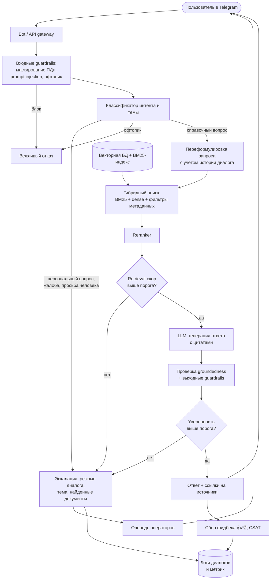
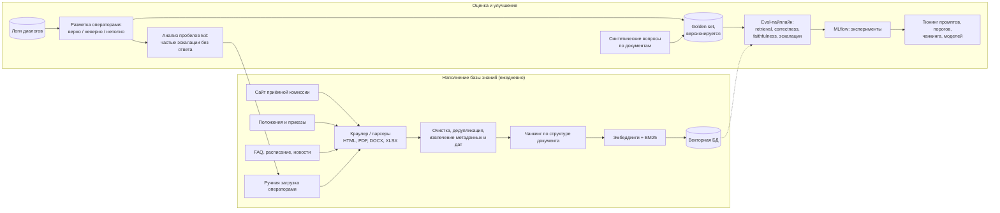

# ML System Design Doc — UniAssist: LLM-агент поддержки студентов и абитуриентов

> Документ составлен по [шаблону Reliable ML](https://github.com/IrinaGoloshchapova/ml_system_design_doc_ru/blob/main/ML_System_Design_Doc_Template.md).
> Статус: черновик, итерация 1 (MVP). Все числовые оценки помечены как гипотезы. Их нужно уточнить у заказчика или на данных пилота.

## Глоссарий

| Термин | Значение |
|---|---|
| **Обращение** | Одна сессия диалога пользователя с ассистентом по одному вопросу |
| **Оператор** | Сотрудник приёмной комиссии, деканата или учебного офиса, который отвечает вручную |
| **Эскалация** | Передача обращения оператору вместе с историей диалога и найденными источниками |
| **Automation rate (AR)** | Доля обращений, закрытых ассистентом без оператора и без повторного обращения по той же теме в течение 24 ч |
| **CSAT** | Средняя оценка ответа пользователем (1–5) или доля 👍 среди оценённых ответов |
| **FRT** | First Response Time, время до первого содержательного ответа |
| **RAG** | Retrieval-Augmented Generation: LLM генерирует ответ на основе найденных фрагментов документов |
| **Groundedness** | Доля утверждений ответа, подтверждённых найденными источниками |
| **База знаний (БЗ)** | Корпус документов: положения, правила приёма, расписания, FAQ, новости |

---

## 1. Цели и предпосылки

### 1.1. Зачем идём в разработку продукта?

**Проблема.** Приёмная комиссия и учебные офисы вуза получают большой поток однотипных вопросов:
«какие проходные баллы», «когда последний день подачи документов», «как перевестись на бюджет», «где посмотреть расписание», «как оформить академический отпуск». Вопросы приходят через чаты, почту, телефон и соцсети. Пик нагрузки приходится на приёмную кампанию (июнь–август) и начало семестра.

Последствия:
- **Долгое ожидание ответа.** В пиковый сезон ответ приходит через часы или дни. Часть абитуриентов за это время уходит к конкурентам. Для вуза это прямая потеря сильных абитуриентов.
- **Перегрузка операторов.** По оценке (гипотеза, уточнить по логам), 60–80 % вопросов покрываются публичными документами и FAQ. Операторы тратят время на повторяющиеся ответы, а не на сложные случаи.
- **Ответы расходятся между собой.** Разные операторы отвечают по-разному, информация устаревает.
- **Информация распределена.** Она лежит на десятках страниц и в PDF-положениях. Пользователю трудно найти нужное самостоятельно.

**Бизнес-цель.** Снизить нагрузку на операторов и время ответа и при этом сохранить или повысить удовлетворённость пользователей. Для этого нужен круглосуточный ассистент, который отвечает на типовые вопросы по официальным документам со ссылками на источник и передаёт человеку то, в чём не уверен.

**Почему станет лучше от ML.**
- Классический FAQ-бот на правилах и кнопках не справляется с разнообразием формулировок и вопросами, ответ на которые нужно собрать из нескольких документов.
- Полнотекстовый поиск по сайту возвращает документ, а не ответ.
- LLM с RAG понимает свободные формулировки, синтезирует ответ из нескольких источников и цитирует их. Механизм уверенности позволяет не отвечать там, где модель может ошибиться.

**Что считаем успехом (целевые бизнес-метрики пилота, гипотезы):**

| Метрика | Текущее значение (оценка) | Цель пилота |
|---|---|---|
| Automation rate | 0 % | ≥ 50 % |
| Медианный FRT | часы (в пик — до суток) | ≤ 10 с |
| CSAT по ответам ассистента | — | ≥ 4.0 из 5 (или ≥ 75 % 👍) |
| CSAT по всем обращениям | baseline замерить до пилота | не ниже baseline |
| Доля фактически неверных ответов (аудит выборки) | — | ≤ 3 % |
| Нагрузка на операторов (обращений/день) | baseline замерить | −40 % |

### 1.2. Бизнес-требования и ограничения

**Заказчик:** приёмная комиссия и учебный офис вуза (пилот на одном вузе).
**Пользователи:** абитуриенты и их родители, студенты бакалавриата и магистратуры.
**Получатели эскалаций:** операторы приёмной комиссии и учебного офиса.

#### Функциональные требования

1. Ответы на вопросы на естественном языке (русский; английский — желательно для иностранных абитуриентов) по темам: правила приёма, сроки, документы, проходные баллы, стоимость обучения, общежития, расписание, учебные процедуры (перевод, отпуск, пересдачи), контакты.
2. Каждый содержательный ответ сопровождается **ссылкой на первоисточник** (документ или страницу и дату актуальности).
3. При низкой уверенности, отсутствии информации, чувствительной теме или явной просьбе пользователя ассистент **эскалирует обращение оператору**: передаёт историю диалога, классифицированную тему и найденные документы. Пользователь получает уведомление о передаче и ориентировочный срок ответа.
4. Многоходовый диалог: уточняющие вопросы («какой уровень образования?», «какая программа?»).
5. Сбор обратной связи: 👍/👎 по ответу и CSAT в конце диалога.
6. Каналы: Telegram-бот (MVP) и виджет на сайте (следующая итерация).
7. Обновление базы знаний без участия разработчиков: регулярная переиндексация публичных страниц и загрузка документов операторами.
8. Панель для операторов: очередь эскалаций, история диалогов, разметка «ответ верный/неверный».

#### Нефункциональные требования

| Требование | Значение |
|---|---|
| Латентность | p95 времени до первого токена ≤ 3 с, полного ответа ≤ 10 с |
| Пиковая нагрузка | до 50 RPS (оценка для пика приёмной кампании), 10 000+ диалогов/день |
| Доступность | 99.5 % в приёмную кампанию; при недоступности LLM сразу эскалировать оператору |
| Актуальность БЗ | изменения на сайте попадают в индекс ≤ 24 ч, критичные документы загружаются вручную ≤ 1 ч |
| Стоимость | ≤ 1–2 ₽ за обращение (LLM + инфраструктура), гипотеза, согласовать бюджет |

#### Бизнес-ограничения

- **Юридическая ответственность за ответы.** Ассистент носит справочный характер. Официальные решения (зачисление, перевод, академические вопросы конкретного студента) он не принимает и не обещает. В интерфейсе есть дисклеймер.
- **Персональные данные (152-ФЗ).** В MVP ассистент не обращается к личным данным (оценки, статус заявления). Персональные данные, введённые пользователем, маскируются перед отправкой в LLM. Логи хранятся в контуре РФ. Если используется внешний LLM API, то это российский провайдер (YandexGPT, GigaChat) либо self-hosted open-source модель.
- **Недопустимые ошибки.** Неверные даты, сроки, суммы и проходные баллы критичнее, чем отказ отвечать. Precision ответов приоритетнее покрытия.
- **Только официальные источники.** Ответы строятся исключительно по базе знаний вуза. Общие знания LLM для фактов о вузе не используются.
- **Тон и этика.** Вежливый нейтральный стиль. Отказ на офтопик, провокации и prompt injection.
- **Ресурсы команды.** 1–2 разработчика, ~3 месяца до пилота, ограниченный бюджет на GPU.

#### Что ожидаем от итерации (MVP)

Рабочий прототип в Telegram на ограниченном домене (приёмная кампания магистратуры и бакалавриата + базовые учебные процедуры), офлайн-оценка на размеченном наборе вопросов и пилот на части трафика.

#### Бизнес-процесс пилота

1. Ассистент подключается в Telegram-канал приёмной комиссии. Операторы продолжают работать как обычно и получают эскалации в общую очередь.
2. **Фаза 1 (2 недели, shadow mode).** Ассистент генерирует ответы, но пользователю их не показывает. Операторы видят черновик и размечают его как верный, неверный или неполный. Так мы замеряем качество без риска для пользователей.
3. **Фаза 2 (4 недели, A/B).** 50 % новых обращений идут в ассистента, 50 % — в текущий процесс. Сравниваем FRT, CSAT, нагрузку на операторов и долю повторных обращений.
4. Еженедельно операторы аудируют случайную выборку из 100 ответов ассистента.

**Успешный пилот:** в A/B AR ≥ 50 %, CSAT в тестовой группе не ниже контрольной, доля критических ошибок по аудиту ≤ 3 %, операторы готовы продолжать (опрос).

**Критерии остановки пилота:** доля критических ошибок > 5 % на недельном аудите, серьёзный инцидент (например, неверный дедлайн привёл к пропуску подачи), утечка ПДн.

#### Возможные пути развития

- Интеграция с личным кабинетом (статус заявления, персональное расписание) после авторизации.
- Виджет на сайте, VK, голосовой канал.
- Проактивные рассылки (напоминания о дедлайнах).
- Расширение на другие подразделения: общежития, военный учебный центр, международный отдел.
- Аналитика частых вопросов для улучшения сайта и документов.

### 1.3. Что входит в скоуп проекта/итерации, что не входит

#### Входит в скоуп итерации (MVP)

| Бизнес-требование | Как закрываем |
|---|---|
| Ответы на типовые вопросы абитуриентов и студентов | RAG по базе знаний из публичных источников вуза |
| Ссылки на источники | Цитирование чанков с URL и датой документа |
| Эскалация при неуверенности | Модуль оценки уверенности + классификатор тем, требующих человека |
| Многоходовый диалог | Хранение контекста сессии, переформулировка запроса с учётом истории |
| Обратная связь | 👍/👎 и CSAT в Telegram |
| Обновление БЗ | Ежедневный краулер + ручная загрузка документов |
| Офлайн-оценка качества | Golden set (300–500 вопросов) и автоматический eval-пайплайн |
| Мониторинг | Логи, метрики латентности, стоимости, AR и эскалаций |

#### Не входит в скоуп итерации

- Доступ к персональным данным и личному кабинету, авторизация.
- Действия от имени пользователя (подача заявлений, запись на пересдачу).
- Сайт-виджет, голосовой канал, другие мессенджеры.
- Полноценная панель операторов. В MVP эскалации уходят в рабочий Telegram-чат операторов, разметка ведётся через простую веб-форму или таблицу.
- Дообучение (fine-tuning) LLM. Используем готовые модели и prompt engineering.
- Английский язык (поддерживается «как получится», без отдельной оценки качества).

#### Результат с точки зрения качества кода и воспроизводимости

- Репозиторий с настроенными линтерами (ruff), mypy, pre-commit и CI.
- Код разбит на модули: ingestion, retrieval, agent, bot, eval. Конфигурация через `.env`/YAML.
- Воспроизводимый запуск через Docker Compose (бот, API, векторная БД, мониторинг).
- Eval-пайплайн запускается одной командой и логирует результаты (MLflow).
- Версионирование golden set и снапшотов БЗ.
- Unit-тесты на парсинг, чанкинг и логику эскалации.

#### Планируемый технический долг

- Простая эвристика оценки уверенности вместо откалиброванной модели. Калибровку делаем после сбора данных пилота.
- Парсинг сложных PDF (таблицы проходных баллов) частично ручной.
- Без продвинутого кэширования ответов и семантического кэша.
- Панель операторов на минимальном уровне.

### 1.4. Предпосылки решения

**Данные:**

| Источник | Пример содержимого | Формат | Частота обновления |
|---|---|---|---|
| Сайт приёмной комиссии | правила приёма, сроки, перечень документов, стоимость | HTML | раз в сезон, изменения в кампанию — еженедельно |
| Положения и приказы | положение о переводе, об академическом отпуске, правила пересдач | PDF/DOCX | редко |
| Официальный FAQ | готовые пары «вопрос — ответ» | HTML | редко |
| Проходные баллы и конкурсные списки | таблицы по программам | HTML/PDF/XLSX | ежегодно, в кампанию — ежедневно |
| Расписание | расписание занятий и сессии | HTML/API | каждый семестр |
| Новости и объявления | изменения сроков, дни открытых дверей | HTML | ежедневно |
| Исторические обращения (если заказчик предоставит) | вопросы пользователей и ответы операторов | выгрузка чатов/почты | разово + поток из пилота |

- Публичные данные доступны для сбора. Нужно соблюдать robots.txt и лицензионные ограничения.
- Исторические обращения нужны для построения golden set и распределения тем. Их обезличиваем до использования. Если их нет, генерируем вопросы синтетически (LLM по документам) и собираем у студентов-волонтёров.
- Объём БЗ по оценке: 500–2 000 документов, 20–50 тыс. чанков. Это небольшой объём, индекс помещается в память одного узла.

**Ключевые предпосылки и допущения:**
- Большинство вопросов имеют ответ в публичных документах (гипотеза: ≥ 60 %). Проверяем на выборке исторических обращений до разработки.
- Ответ всегда даётся на один вопрос в контексте одной сессии. Долгосрочная память о пользователе не нужна.
- Документы на сайте считаются истиной. Если они противоречат друг другу, приоритет у более свежего документа, а сам конфликт эскалируется.
- Актуальность важнее полноты: у каждого чанка есть дата. Устаревшие документы (например, правила прошлого года) помечаются и понижаются в выдаче.
- Пользователи готовы общаться в Telegram (основной канал коммуникации абитуриентов).
- Операторы готовы разбирать эскалации и размечать ответы в пилоте (нужно согласовать с руководителем приёмной комиссии).

---

## 2. Методология

### 2.1. Постановка задачи

С технической точки зрения задача раскладывается на несколько подзадач:

1. **Retrieval (информационный поиск).** По запросу пользователя с учётом истории диалога найти top-k релевантных фрагментов базы знаний.
   - Гибридный поиск: dense (эмбеддинги, например `bge-m3` / `multilingual-e5-large`) + sparse (BM25), слияние через Reciprocal Rank Fusion, затем cross-encoder reranker (`bge-reranker-v2-m3`).
   - Фильтрация по метаданным: уровень образования, год, тип документа.
2. **Генерация ответа (grounded QA).** LLM формирует ответ только на основе найденных фрагментов, с цитированием источников. Если информации нет, модель должна это явно сказать.
3. **Маршрутизация и решение об эскалации (selective prediction).** Бинарная классификация «отвечать или эскалировать» на основе признаков:
   - классификатор интента и темы (FAQ / процедурный вопрос / персональный вопрос / жалоба / офтопик);
   - скоры retrieval и reranker (максимальный скор, разрыв между top-1 и top-2);
   - groundedness-проверка ответа (LLM-as-judge или NLI-модель): подтверждены ли утверждения источниками;
   - явная просьба позвать человека, негативная тональность, чувствительные темы.
   В MVP это пороговые правила, в следующей итерации — откалиброванная модель (логрег/бустинг) на размеченных данных пилота.
4. **Guardrails.** Детекция prompt injection и офтопика, маскирование ПДн на входе, проверка выхода на запрещённый контент.

Такой многошаговый процесс оформляем как **агент** (граф состояний, например на LangGraph): узлы классификации, переформулировки запроса, поиска, генерации, проверки и эскалации. Инструменты агента: `search_kb`, `get_schedule`, `escalate_to_operator`.

**Вход:** текст сообщения пользователя, история сессии (последние N реплик), метаданные канала.
**Выход:** ответ с цитатами **или** эскалация (тема + краткое резюме диалога + найденные источники для оператора).

**Бейзлайн.** BM25-поиск по FAQ: возвращаем ближайшую пару «вопрос — ответ» при скоре выше порога, иначе эскалируем. Он даёт нижнюю границу качества и проверяет, оправдана ли LLM.

**ML-метрики (офлайн, на golden set):**

| Компонент | Метрика | Целевое значение (гипотеза) |
|---|---|---|
| Retrieval | Recall@5, MRR@10 | Recall@5 ≥ 0.85 |
| Генерация | Answer correctness (LLM-judge + ручная проверка выборки) | ≥ 0.85 |
| Генерация | Faithfulness / groundedness | ≥ 0.95 |
| Генерация | Citation accuracy (цитата подтверждает утверждение) | ≥ 0.9 |
| Эскалация | Precision ответов среди неэскалированных (= 1 − доля ошибок) | ≥ 0.97 |
| Эскалация | Coverage (доля вопросов без эскалации) при заданной precision | ≥ 0.6 |
| Классификатор тем | macro-F1 | ≥ 0.8 |
| Guardrails | Доля пропущенных prompt injection на тестовом наборе | ≤ 2 % |
| Система | p95 латентность, стоимость за обращение | ≤ 10 с, ≤ 2 ₽ |

Главный компромисс — **coverage против precision**. Порог эскалации подбираем по кривой risk–coverage так, чтобы precision ответов была ≥ 0.97, и при этом максимизируем coverage. Именно он напрямую определяет бизнес-метрику AR.

**Связь ML-метрик с бизнес-метриками:**
- Coverage × (1 − доля повторных обращений) ≈ Automation rate.
- Precision / answer correctness → CSAT и доля критических ошибок.
- Латентность → FRT.

### 2.2. Блок-схема решения

#### Онлайн-контур: обработка обращения

#### Офлайн-контур: база знаний, оценка, улучшение

### 2.3. Этапы решения задачи

| Этап | Содержание | Результат / критерий готовности |
|---|---|---|
| **0. Анализ и сбор данных** | Анализ выборки исторических обращений (если есть): распределение тем, доля вопросов с ответом в документах. Краулинг источников, парсинг. | Корпус БЗ, отчёт о покрытии тем, проверенная гипотеза «≥ 60 % вопросов закрываются документами» |
| **1. Golden set** | 300–500 вопросов: реальные обезличенные + синтетические + вопросы-ловушки (нет ответа, устаревшая информация, injection). Эталонные ответы и релевантные документы размечаются вручную. | Версионированный датасет, согласие разметчиков (две независимые разметки на 20 % выборки) |
| **2. Бейзлайн** | BM25 по FAQ с порогом. | Замеренные метрики бейзлайна |
| **3. RAG MVP** | Чанкинг, гибридный поиск, reranker, генерация с цитатами. Эксперименты со стратегией чанкинга, моделями эмбеддингов и LLM (сравнение 2–3 вариантов по качеству, цене, латентности). | Recall@5 ≥ 0.85, correctness ≥ 0.85 на golden set |
| **4. Агент и эскалация** | Граф агента, классификатор интентов, guardrails, подбор порогов по risk–coverage. | Precision ≥ 0.97 при coverage ≥ 0.6 |
| **5. Сервис** | Telegram-бот, API, Docker Compose, логирование, мониторинг (латентность, стоимость, AR, эскалации). | Нагрузочный тест: p95 ≤ 10 с на целевой нагрузке |
| **6. Пилот** | Shadow mode → A/B (см. 1.2). | Отчёт по бизнес-метрикам, решение о масштабировании |

---

## 3. Риски

| Риск | Вероятность | Влияние | Митигация |
|---|---|---|---|
| Галлюцинации (выдуманные даты, суммы) | Средняя | Высокое | Строгий grounded-промпт, проверка groundedness, консервативный порог эскалации, аудит выборки |
| Устаревшая информация в БЗ | Высокая | Высокое | Метаданные дат, ежедневная переиндексация, приоритет свежих документов, алерты на изменения ключевых страниц |
| Противоречия между документами | Средняя | Среднее | Детекция конфликтов в выдаче → эскалация, отчёт для владельцев контента |
| Prompt injection, токсичный ввод | Средняя | Среднее | Входные и выходные guardrails, red teaming на тестовом наборе |
| Утечка ПДн во внешний LLM | Низкая | Высокое | Маскирование ПДн, российский провайдер или self-hosted модель, хранение логов в РФ |
| Пиковая нагрузка в приёмную кампанию | Высокая | Среднее | Автомасштабирование, лимиты, fallback на эскалацию при деградации LLM |
| Операторы не успевают разбирать эскалации | Средняя | Среднее | Резюме диалога и найденные документы в эскалации, приоритизация очереди |
| Недоверие пользователей к боту | Средняя | Среднее | Ссылки на источники, кнопка «позвать человека» всегда доступна |

## 4. Предварительный технологический стек

| Слой | Технологии (кандидаты) |
|---|---|
| LLM | YandexGPT / GigaChat через API или self-hosted Qwen / T-lite (vLLM). Выбор по итогам этапа 3 |
| Эмбеддинги, reranker | `bge-m3`, `multilingual-e5-large`, `bge-reranker-v2-m3` |
| Векторная БД | Qdrant (dense + sparse) |
| Оркестрация агента | LangGraph |
| Сервис | Python 3.11, FastAPI, aiogram (Telegram), PostgreSQL (диалоги, фидбек), Redis (сессии) |
| Данные | Scrapy / httpx + BeautifulSoup, `unstructured` / `pymupdf` для PDF |
| Оценка | Собственный eval-пайплайн + RAGAS, MLflow |
| Наблюдаемость | Prometheus, Grafana, Langfuse (трейсы LLM) |
| Инфраструктура | Docker Compose (MVP), GitHub Actions (CI) |

## 5. Открытые вопросы

- Предоставит ли заказчик исторические обращения и в каком объёме?
- Какой LLM-провайдер допустим с точки зрения безопасности и бюджета?
- Кто владеет контентом БЗ и отвечает за актуальность документов?
- Какой SLA операторы могут обеспечить по эскалациям в пиковый сезон?
