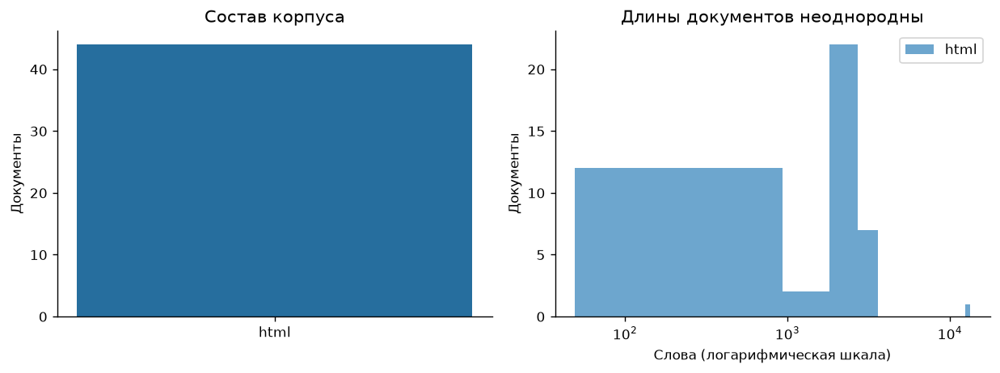
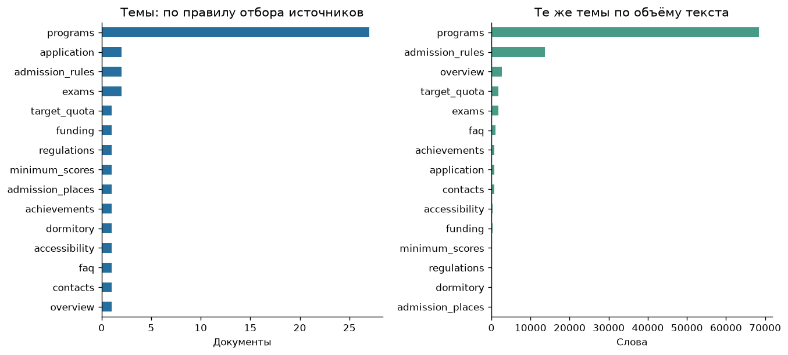
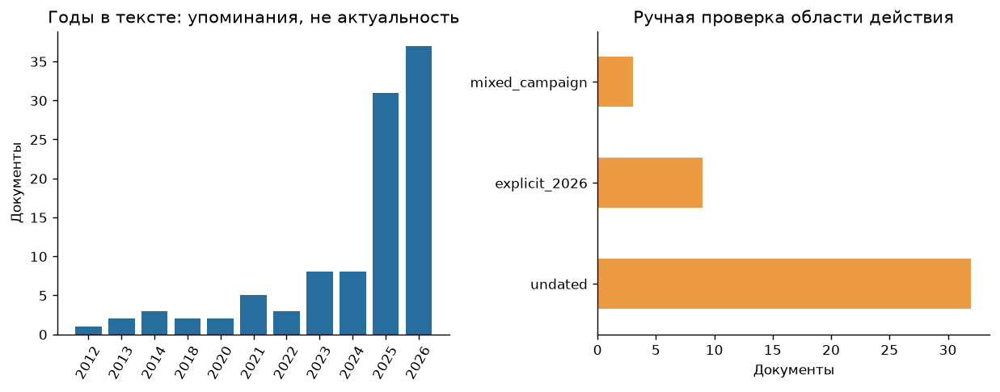
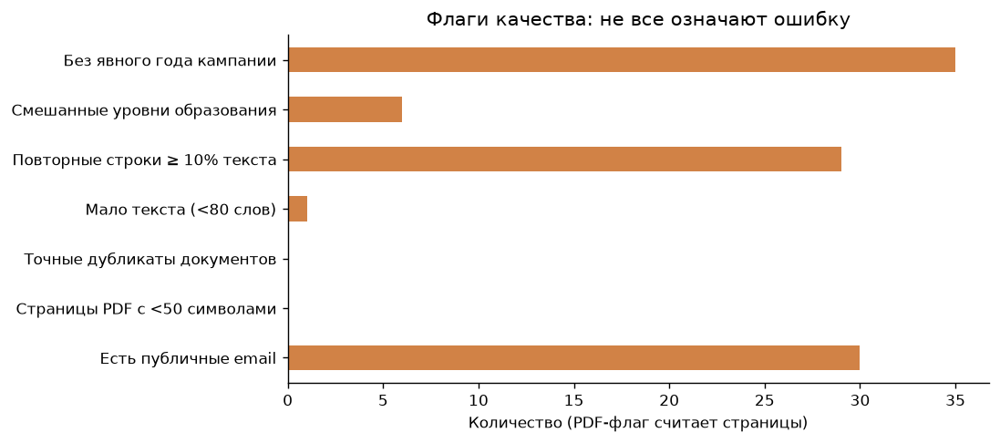
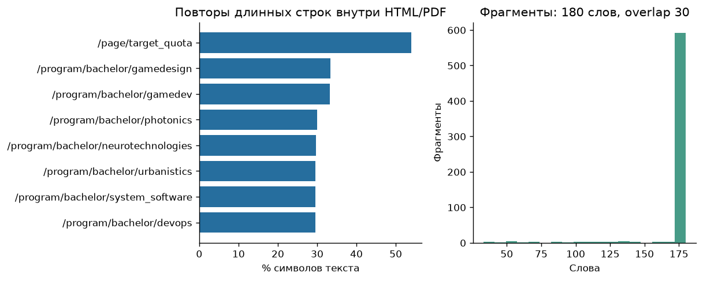
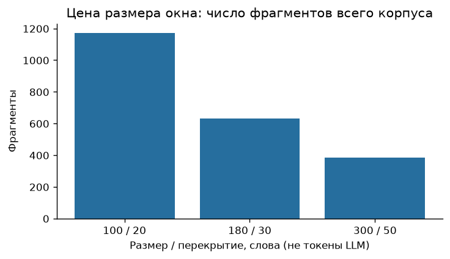

# EDA корпуса ИТМО для UniAssist

Дата: 11 ноября 2026 года. Итерация: HW2. Область: справочные вопросы о поступлении на бакалавриат. Источник — [официальный портал абитуриентов ИТМО](https://abit.itmo.ru/). Это учебное офлайн-исследование; оно не согласовано как сервис университета.

## Данные, происхождение и воспроизводимость

Сначала изучена карта сайта: 403 URL. Отобраны русскоязычные информационные `/page/…`, паспорта бакалавриата и четыре служебные страницы для оценки состава. Получено 81 из 82 документов; полный реестр решений — [discovery.csv](../data/sources/discovery.csv). Этот обзор включал страницы других аудиторий; они не входят в рабочий корпус. Автоматический сбор не использует API, личный кабинет, рейтинги или query-параметры.

Для рабочего снимка выбран 59-строчный [реестр](../data/sources/registry.csv): 44 HTML и 15 ссылок на нормативные PDF. Все 44 HTML получены; 15 PDF пропущены **до HTTP-запроса**, потому что `/file_storage/` закрыт robots.txt. Общий `Allow: */*.pdf` не отменяет более конкретный запрет каталога; он также не имеет стандартного начального `/`. Это не 15 серверных ошибок и не доказательство отсутствия файлов. [Политика портала](https://abit.itmo.ru/robots.txt) сохранена со своим хешем. Содержимое PDF, OCR и табличный парсинг PDF не оценивались.

Сбор последовательный, не чаще 1 запроса/с. Каждый переход проверяется по allowlist и robots; лимит ответа — 20 MiB. Есть обработка gzip и сохранение SHA-256 декодированного HTTP-тела. Исходники остаются локально в `data/raw/20261111_itmo_bachelor_v1/`, тексты и фрагменты — в `data/processed/20261111_itmo_bachelor_reviewed_v2/`. Ни один исходный снимок не перезаписан.

Публичные результаты воспроизводятся без сети из [диагностических CSV](data/20261111_itmo_bachelor_reviewed_v2/): `make eda`, `make notebook`. Повторное скачивание создаёт новую версию, которая может отличаться содержимым сайта. Порядок сборки и требования к локальным исходникам: [data/README.md](../data/README.md).

## 1. Состав и объём

| Показатель | Значение |
|---|---:|
| Загружено HTML | 44 |
| PDF в реестре / получено | 15 / 0 |
| Суммарный размер HTML-тел | 16 981 098 байт (16,19 MiB) |
| Извлечённый текст | 719 463 символа |
| Слова по разделению пробелами | 92 892 |
| Медиана длины документа | 2 414,5 слова |
| Минимум / максимум | 49 / 13 302 слова |
| Окна 180 слов, overlap 30 | 631 |
| После карантина для BM25 | 40 документов, 576 фрагментов |

**Наблюдение.** Длины различаются более чем на два порядка; правила приёма значительно длиннее коротких справочных страниц. HTML-байты включают разметку, встроенный JSON и изображения и не равны полезному тексту.

**Решение.** Индексировать фрагменты с указанием источника; при оценке отдельно считать документы, слова, символы и окна. Слова здесь не являются токенами конкретной LLM. Снимок целевой, а не случайный; число документов не доказывает достаточное покрытие запросов.

## 2. Темы и полезный объём

27 из 44 документов — паспорта образовательных программ (61,4%). Остальные — FAQ, правила, документы для подачи, достижения, испытания, минимальные баллы, общежития, контакты, целевой набор и финансирование. Тема определяется типом страницы вручную в реестре, не классификатором. Объём правил приёма велик при малом числе соответствующих URL.

**Вывод.** Распределение URL по темам не описывает спрос. Нельзя выдавать высокую метрику по многочисленным похожим программам за качество ответов о сроках и документах. Для будущих вопросов нужна стратификация по задачам и независимая оценка критических тем.

## 3. Актуальность и смешение кампаний

График слева считает документы, в которых упоминается год. Он не назначает году статус «действующий». В 35 документах исходного реестра нет подтверждённого единого года кампании. Встречаются исторические годы олимпиад, лицензий, постановлений и проходных баллов — сами по себе это не ошибки.

Детальная проверка обнаружила начало приёма **20 июня 2025** в разделах основных дат трёх паспортов: [AI360](https://abit.itmo.ru/program/bachelor/ai), [Компьютерные технологии](https://abit.itmo.ru/program/bachelor/programming), [Software Engineering](https://abit.itmo.ru/program/bachelor/software_engineering). [Правила](https://abit.itmo.ru/page/66) и [FAQ](https://abit.itmo.ru/faq) явно описывают кампанию 2026. Это подтверждённое смешение областей действия в доступном корпусе; оно не доказывает, что все поля трёх программ устарели.

**Решение.** Три паспорта временно исключены целиком; причины, хеши и смещения свидетельств записаны в [review.csv](../data/sources/review.csv). Следующий вариант должен размечать год на уровне секции и не переносить даты 2026 на вопросы о 2027. Дата загрузки не заменяет дату действия. Официальный сайт является первоисточником, но это не делает все его разделы взаимно согласованными.

## 4. Качество извлечения и неполные таблицы

- На `/page/71` получено 49 слов: заголовки таблицы количества мест без её значений. Документ исключён из поиска по порогу `<80 слов`. Этот порог — простой диагностический фильтр, он не обнаруживает все неполные документы.
- Проверены контрольные страницы `/faq`, `/page/66`, `/page/69`, `/page/73`, `/page/74`, `/page/86`, `/page/90`, `/page/61`, `/contacts` и три паспорта с историческими сроками. Это целевая проверка текста, не независимый аудит случайной выборки и не визуальная сверка всех страниц.
- В таблице минимальных баллов `/page/73` есть повторяющиеся значения 60. Их нельзя удалять как дубликаты строк. В `/page/69` условия, достижение и балл должны остаться одной записью.
- В шести документах отмечены разные уровни образования. Например, страница `/page/74` сначала описывает магистратуру, хотя заголовок связан с бакалавриатом; `/page/86` содержит оба уровня. Нужна секционная фильтрация. Текущий эксперимент её не реализует.
- Чистка удаляет структурные `nav/header/footer/script/style`, но при fallback к `body` часть меню и повторных блоков, оформленных обычными `div`, остаётся. Отсутствие пустого текста не доказывает качественное извлечение.

**Вывод.** Факт HTTP 200 и достаточная длина текста недостаточны. Перед генерацией ответа нужны проверки структуры таблиц, выбранного уровня образования и актуальности критических полей. Для недоступной таблицы безопасный исход — указать пробел и передать оператору, а не восстановить числа из похожей программы.

PDF-флаг на графике равен нулю потому, что PDF нет в полученном корпусе. Его нельзя интерпретировать как отсутствие проблем с текстовым слоем.

## 5. Повторы и дубликаты

Точных дубликатов полных извлечённых документов в выбранном корпусе нет. В 29 документах не менее 10% символов приходятся на повторные вхождения строк длиной от 30 символов. Метрика чувствительна к разбиению строк; короткие числовые ячейки в неё не входят. Максимум — 53,95% на странице целевой квоты.

Междокументная проверка: Jaccard по множествам последовательностей из пяти нормализованных слов, порог 0,35; найдено 296 пар. Максимум — 0,7644 у [«Геймдизайна»](https://abit.itmo.ru/program/bachelor/gamedesign) и [«Технологий разработки компьютерных игр»](https://abit.itmo.ru/program/bachelor/gamedev). Общие правила поступления создают высокое сходство разных программ. Все пары и коэффициенты — [near_duplicates.csv](data/20261111_itmo_bachelor_reviewed_v2/near_duplicates.csv).

**Решение.** Не удалять весь похожий паспорт: можно потерять программу, стоимость или условия. Выделить общие блоки в отдельные канонические записи, сохранить происхождение и уникальные поля программ. При оценке поиска контролировать занятость top-k одним общим шаблоном. Текущий бейзлайн сохраняет эти повторы как измеренную исходную проблему.

## 6. Размер фрагмента и потери структуры

| Размер / overlap, слова | Число окон до карантина |
|---|---:|
| 100 / 20 | 1 172 |
| 180 / 30 | 631 |
| 300 / 50 | 385 |

Уменьшение размера увеличивает индекс и риск разрыва контекста. Увеличение добавляет нерелевантные соседние правила и может смешать годы и уровни. Выбранные 180/30 — стартовая фиксированная конфигурация, не победитель оптимизации по этим данным.

**Гипотеза для следующего эксперимента.** Структурный чанкинг по FAQ, разделам правил и строкам таблиц даст больше, чем увеличение размера модели при той же плохой структуре. Сейчас эта гипотеза не проверена.

## 7. Разметка, конфиденциальность и достаточность

Созданы 36 модельных случаев разработки: 24 с одним известным подтверждением и 12 сценариев уточнения/эскалации/отказа. Это не исторические диалоги и не независимые вопросы студентов. Указаны происхождение, split, хеши и offsets. Ошибки разметки и неполные qrels возможны; нужна независимая проверка. [Инструкция и схема](../data/evaluation/README.md).

Email найдены в 30 документах; в паспортах есть имена и контакты сотрудников. Проверка regex не заменяет аудит персональных данных. Локально сохраняются публичные исходники, в Git — реестр, агрегаты и диагностические таблицы без полных текстов и значений извлечённых контактов. Право на массовую перепубликацию исходного корпуса не подтверждено. Случаи с паспортами, реальными заявлениями, чатами или идентификацией пользователей не собирались. Обнаруженная при разведке страница результатов испытаний исключена из рабочего корпуса.

**Итог для проектирования.** Данных достаточно для исследования источников и первого поиска. Недостаточно для оценки корректности полноценного RAG, реального покрытия тем, precision ≥0,97, CSAT или automation rate. Следующие работы: независимые вопросы, разметка секций, разрешённый экспорт неполных таблиц и PDF, затем сравнение предобработки и retrieval на общем наборе. Текущие пробелы отражены в [дизайн-документе](../docs/ml_system_design_doc.md).
